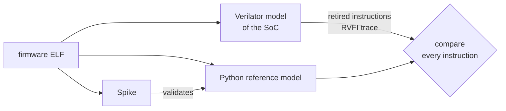

# rv32i-soc-validation

Instruction-by-instruction verification of a RISC-V SoC before silicon. Every instruction the
[rv32i-soc-asic](https://github.com/Manas-Punjabi/rv32i-soc-asic) RTL executes is checked, as it
retires, against a reference simulator that was itself validated against Spike, the official
RISC-V model.

`Python` · `C` · `C++` · `SystemVerilog` · `Verilator` · `Icarus` · `Spike` · `RISC-V` · `RVFI`

## Results

| | |
|---|---|
| **Programs checked in lockstep** | 319 — riscv-tests, firmware, directed, random, stress and random-interrupt programs — all matching |
| **Instructions compared** | 177,669 in the main regression; 103,043 for the full firmware benchmark |
| **Reference model** | identical to Spike on 38,822 instructions (firmware, random programs, 55 riscv-tests) |
| **Checker strength** | 28 / 28 of the SoC’s injected RTL bugs caught (26 by the comparison itself); 9 / 9 injected reference-model bugs caught |
| **Functional coverage** | 228 / 228 architectural bins (hazards, traps, CSRs, interrupts, memory-mapped I/O) |
| **Code coverage** | 97.1 % line, 96.2 % branch on the RTL |
| **Simulator cross-check** | Verilator and Icarus produce identical traces, cycle for cycle |

Raw output behind every number: [`docs/reports/`](docs/reports/).

## How it works



The SoC's RTL is compiled with Verilator and reports each instruction it completes through the
standard RISC-V Formal Interface (RVFI): its PC, the instruction, the register it wrote, any
memory access, and the next PC. A reference model written in Python runs the same program and
must produce exactly the same record for every instruction. The first difference stops the run
and names the instruction and the field.

Spike cannot model this SoC's timer, UART or accelerator, so the reference model is a separate
simulator, checked against Spike on everything Spike can run. Values only the hardware knows
(peripheral reads, cycle counters, when an interrupt arrives) are taken from the RTL and fed to
the model, which then checks that everything that follows is correct. This is the approach used
by production RISC-V cores such as lowRISC Ibex.

## Verification

| Check | Result |
|---|---|
| Reference model vs Spike | identical traces on firmware, random programs and 55 riscv-tests |
| Lockstep regression | 111 programs: riscv-tests, firmware, the SoC smoke test, 50 random programs |
| Directed tests | 8: `fence.i`, CSR operations, pipeline hazards, far code, `mret`, interrupts, memory-mapped registers, `wfi` |
| Constrained-random stress | 150 programs: loops, CSR chains, traps, bus stalls, pointer chasing |
| Random interrupts | 50 programs, 573 interrupts taken and checked |
| Mutation testing | the SoC's own 28 injected bugs, each caught, after a control run in which every program passes on the unmodified design |
| Random initial state | all four regressions re-run under 3 random seeds for every uninitialized RTL bit: all match |
| Two simulators | Verilator and Icarus, identical traces |

The mutation test is the point of the table: a checker that never fails proves nothing, so every
comparison here has a deliberately broken input that must make it fail.

## Reproduce

```bash
sudo apt install gcc-riscv64-unknown-elf verilator iverilog device-tree-compiler
# Spike: build riscv-isa-sim from source into ~/opt/spike
# riscv-tests: clone with its env submodule into ~/src/riscv-tests
# rv32i-soc-asic: clone next to this repository
make verify        # reference model vs Spike, checker self-tests   (~25 s)
make cosim-all     # lockstep regression on the SoC
make directed      # directed tests
make stress        # constrained-random programs
make mutate-rtl    # every injected RTL bug must be caught          (~15 min)
```

Every target and its expected result: the [`Makefile`](Makefile) header and
[docs/verification.md](docs/verification.md).

## Repository layout

| Path | Contents |
|---|---|
| `cosim/` | reference model (`iss.py`), trace format, Spike log parser, lockstep compare, device models, random program generator |
| `tb/` | Verilator and Icarus harnesses around the SoC, coverage configuration |
| `tb/asm/` | directed test programs |
| `sw/` | startup code, linker script, memory map, firmware tests |
| `scripts/` | mutation tests, riscv-tests runner, simulator cross-checks, coverage tools |
| `docs/` | [architecture.md](docs/architecture.md) (how the comparison works), [verification.md](docs/verification.md) (every check and result), [DECISIONS.md](docs/DECISIONS.md), `reports/` |

## Known limitations

- A **missing** interrupt is not detected by the comparison, only a wrong one; interrupt tests
  use bounded waits and self-checks for that.
- The SoC is simulated with its flop-based memory, which models the SRAM macro's timing, not
  with the SRAM's own behavioural model.

## License

MIT
