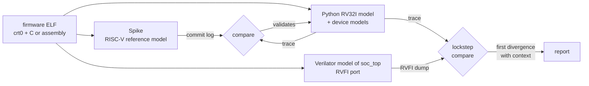

# Architecture

This repository validates [rv32i-soc-asic](https://github.com/Manas-Punjabi/rv32i-soc-asic) by
lockstep co-simulation: a Verilator model of the finished SoC runs real firmware, and every
instruction it retires is checked against a reference instruction-set simulator. This document
describes how the comparison works. [verification.md](verification.md) has every check and its
result, and [DECISIONS.md](DECISIONS.md) the reasoning behind each design choice.



## Why a reference model of its own

Spike has no model of this SoC's peripherals. The first time firmware reads the accelerator's
STATUS register, Spike's register file diverges from the RTL, and every later comparison fails.
The Python model (`cosim/iss.py`) routes `0x4000_0000`–`0x4FFF_FFFF` to a pluggable handler:
device models when firmware runs on the model alone, or the RTL's observed value when it runs in
lockstep. Spike's role is to prove the model correct on everything that does not touch those
devices.

## ISA scope

The core is RV32I + Zicsr + Zicntr + Zifencei with machine-mode traps and interrupts, and the
model matches it: machine-mode CSRs, exceptions (illegal instruction, `ecall`, `ebreak`,
misaligned load/store/fetch) to `mtvec`, `mret`, and interrupts. Spike is configured as the same
machine:

```
spike --isa=rv32i_zicsr_zicntr_zifencei --priv=M --pmpregions=0 --triggers=0
```

Without `--priv=M`, Spike has S and U modes and accepts `satp`/`medeleg` writes that trap on an
M-only core; without `--pmpregions=0 --triggers=0` it has PMP and debug triggers the core lacks.
Zicntr is required: without it Spike traps on counter reads the core executes
([spike_isa_string.txt](reports/spike_isa_string.txt)).

**riscv-tests: 55 of 58 run**, the same 55 rv32i-soc-asic runs on the RTL: 41 `rv32ui` and 14
`rv32mi`. Excluded: `rv32ui/ma_data` (misaligned data access traps on this core, which is
spec-legal), `rv32mi/pmpaddr` (no PMP) and `rv32mi/breakpoint` (no debug triggers). On the last
one the RTL was checked by execution: `csrr t0, tselect` traps with `mcause` = 2 and `mepc` at the
`csrr`. Spike does not trap on `tselect` even with `--triggers=0`, so firmware that touches
trigger CSRs diverges between Spike and the model; that is a known Spike difference, not a model
bug.

**Two ways Spike's log and RVFI differ**, and how each is handled:

| Difference | Handling |
|---|---|
| Spike's commit log omits trapping instructions; RVFI reports them with `trap` = 1 | the model emits trap records and they are dropped for the Spike comparison only; a misplaced trap still shows up as a PC mismatch at the next instruction |
| RVFI `mem_addr` is word-aligned with byte lanes in the masks; Spike and the model use byte addresses | the RVFI reader adds the lowest set lane to the address |

## The RTL side

`tb/cosim_top.sv` wraps rv32i-soc-asic's `soc_top`, built with its RVFI port
(`-DRVFI`), from the flop memory (`USE_SRAM=0`, 64 KB), which models the SRAM macro's read timing
cycle for cycle. The OpenRAM behavioural model has `#` delays and is not a Verilator target. UART
and GPIO are wired in loopback. `cosim_top` loads the program image (`+hex`) straight into the
memory array with a hierarchical `$readmemh`, as rv32i-soc-asic's own testbench does, so
rv32i-soc-asic's RTL is used unmodified. `tb/sim_main.cpp` drives the Verilator model and writes
the RVFI dump; `tb/tb_icarus.sv` runs the same wrapper under Icarus Verilog for the simulator
cross-check. All uninitialized RTL state can be randomized with `SEED=n`
(`--x-assign unique --x-initial unique`).

Each retired instruction produces one RVFI record: `order`, `insn`, `trap`, `pc_rdata`,
`pc_wdata`, `rd_addr`, `rd_wdata`, `mem_addr`, `mem_rmask`, `mem_wmask`, `mem_rdata`,
`mem_wdata`, and, for taken interrupts, the side band `rvfi_intr`, `rvfi_ext_mcause` and
`rvfi_ext_mip`. The reader rejects malformed traces: a gap in `order`, or a nonzero `rd_wdata`
with `rd_addr` = 0.

## Guided lockstep

A plain offline comparison fails at the first value the reference model cannot know:

- **counter CSRs:** the RTL's `mcycle` depends on its pipeline;
- **ID CSRs:** `marchid`, `mimpid` and `mvendorid` are implementation-defined;
- **peripheral loads:** the RTL accelerator takes N + 4 cycles where the model is instant, so
  STATUS polls read differently; the timer, UART and GPIO likewise;
- **`mip`:** it mirrors device interrupt lines the model does not time.

`cosim/compare.py` steps the model once per RTL retirement and, for exactly those
instructions, injects the RTL's value before the model executes. Everything else is computed
independently and compared: PC, instruction, destination register and value, memory address,
data and byte lanes, the trap flag, and the next PC (`pc_wdata`). The first difference stops the
run and prints the instruction, the field and the instructions before it.

**Interrupts.** The RTL says *that* an interrupt was taken and which one. The model checks it was
legal (`mstatus.MIE` set, the source enabled in `mie` and pending in `mip`) and the highest
priority pending (external > software > timer), then performs the trap entry itself, so `mepc`,
`mcause`, `mtval` and `mstatus` are compared rather than copied. Interrupt programs run in
lockstep only when rv32i-soc-asic's RVFI side band is present, which it is in the published RTL.

**Address decode.** The model follows `soc_top`'s decode, not Spike's: unmapped addresses read 0
and drop writes, and RAM aliases across `0x8xxx_xxxx`. A fetch outside RAM is a hard error,
because it means a broken program.

## Programs and generators

| Source | What it is |
|---|---|
| `sw/` | startup code, linker script and memory map shared with rv32i-soc-asic; firmware tests for the ISA, the accelerator, counters and the SoC's address map |
| rv32i-soc-asic `sw/main.c` | the accelerator benchmark, built unchanged |
| riscv-tests | the 55 `rv32ui` and `rv32mi` programs, run against the design, not copied here |
| `tb/asm/` | 8 directed tests: `fence.i`, CSR operations, pipeline hazards, code above 48 KB, `mret`, interrupts, every SoC register, `wfi` |
| `cosim/randgen.py` | random programs: plain, stress (loops, CSR chains, traps inside hazard chains), MMIO (timer and GPIO accesses, so bus stalls), pointer chasing (computed addresses), interrupts (software and timer interrupts at random points) |

## Device models

When firmware runs on the reference model alone (`make iss`), `cosim/devices.py` provides the
UART, timer, GPIO and accelerator. The accelerator completes instantly, and `mtime` advances once
per retired instruction, so cycle counts printed in those runs are not performance numbers; real
cycles come from the RTL. In lockstep these models are not used: the RTL's values are injected.

## How this compares with industry practice

The method is the one production RISC-V cores use:

- lowRISC Ibex steps Spike from its testbench and feeds it the DUT's memory accesses and
  interrupts [R1, R2]. This repository injects at the same points, but offline, from the RVFI
  dump after the run, so the reference model never has to be linked into the simulation.
- OpenHW CORE-V uses step-and-compare, now with ImperasDV and RVVI [R3].
- riscv-dv compares instruction traces against Spike, Sail and other models [R4].

## References

- [R1] lowRISC Ibex, *Co-simulation system*: https://ibex-core.readthedocs.io/en/latest/03_reference/cosim.html
- [R2] lowRISC Ibex, `dv/cosim/spike_cosim.cc`: https://github.com/lowRISC/ibex/blob/master/dv/cosim/spike_cosim.cc
- [R3] OpenHW CORE-V verification: https://docs.openhwgroup.org/projects/cv32e40p-user-manual/en/latest/verification.html
- [R4] CHIPS Alliance riscv-dv: https://github.com/chipsalliance/riscv-dv
- [R5] Spike (riscv-isa-sim): https://github.com/riscv-software-src/riscv-isa-sim
- [R6] RVFI specification: https://github.com/SymbioticEDA/riscv-formal/blob/master/docs/rvfi.md
- [R7] YosysHQ riscv-formal: https://github.com/YosysHQ/riscv-formal
- [R8] *Crafting a Million Instructions/Sec RISCV-DV*, DVCon: https://dvcon-proceedings.org/wp-content/uploads/1008.pdf
